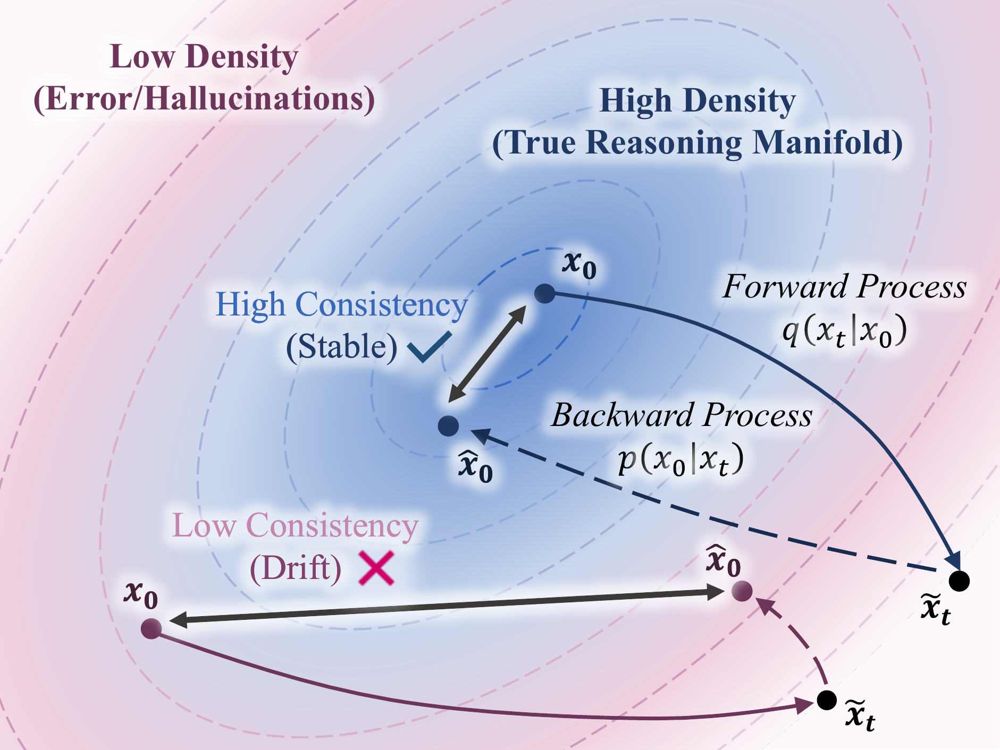
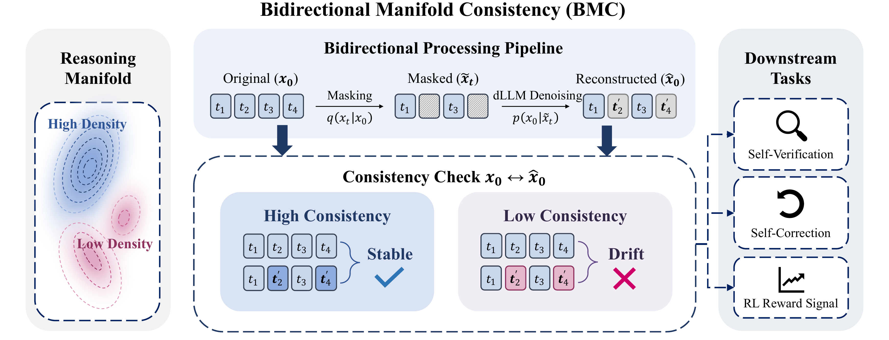

<div align="center">

<h1>Reasoning on the Manifold:<br/>Bidirectional Consistency for Self-Verification in Diffusion Language Models</h1>

Jiaoyang Ruan<sup>&ast;</sup>, Xin Gao<sup>&ast;</sup>, Yinda Chen, Hengyu Zeng, Liang Du, Guanghao Li, Jie Fu, Jian Pu

<sub><sup>&ast;</sup> Equal contribution</sub>

<a href="https://proceedings.mlr.press/v306/ruan26a.html"></a>
<a href="https://arxiv.org/abs/2604.16565"></a>
<a href="https://proceedings.mlr.press/v306/ruan26a.html"></a>



<p align="left"><sub><b>Geometric intuition.</b> BMC probes the stability of an answer <code>x0</code> under a forward–backward cycle.
Valid solutions (blue) act as stable attractors on the high-density manifold and are faithfully reconstructed
(<code>x̂0 ≈ x0</code>); erroneous outputs (purple) drift off-manifold and the reconstruction diverges.</sub></p>

</div>

---

## 📌 Overview

A diffusion LLM writes text by repeatedly masking and denoising it. That gives us a question we cannot ask an
autoregressive model: *if we corrupt an answer and let the model rebuild it, does the same answer come back?*

Whether it does depends on whether the answer was right in the first place. A correct chain of reasoning sits in a
high-density region of the distribution the model has learned, so it behaves like an attractor. Perturb it and the
denoiser pulls it back. A flawed chain sits off that manifold, and the same perturbation is enough to send the
reconstruction somewhere else.

**Bidirectional Manifold Consistency (BMC)** makes this measurable. Given a generated answer `x0`, we re-mask it at
ratio `γ = 0.9`, run only `K = 16` denoising steps to get a reconstruction `x̂0`, and then measure how much of the
original survived. We score the survival with six complementary metrics (token accuracy, semantic similarity, number
retention, final-answer match, character similarity, and the denoiser's own confidence), combine them with learned
weights `λ_k` into a single value `S_BMC ∈ [0, 1]`, and average `N_BMC = 4` independent probes so that one unlucky
reconstruction cannot dominate the result.

<div align="center">

<p align="left"><sub><b>The BMC framework.</b> <b>Left:</b> correct solutions (blue) occupy stable high-density regions of
the reasoning manifold, incorrect ones (purple) lie off-manifold. <b>Centre:</b> the bidirectional pipeline, i.e.
masking <code>x0 → xt</code>, reconstruction <code>xt → x̂0</code>, and the consistency check. <b>Right:</b> the three
downstream applications: verification, correction and RL alignment.</sub></p>
</div>

Computing `S_BMC` needs no labels, no reward model and no additional training. It only needs the generator itself,
which is what lets a single score serve three different points of the reasoning lifecycle:

| Stage | What BMC does | Paper |
|---|---|---|
| 🔎&nbsp;**Diagnosis** | Flags wrong solutions without ever seeing the ground truth (AUROC / AUPR) | §5.2, Table 1 |
| ⚡&nbsp;**Inference** | Manifold-Guided Rejection Sampling (MGRS): keep resampling while `S_BMC < τ`, so that compute goes to the problems that actually need it | §4.2, §5.3, Table 2 |
| 🎯&nbsp;**Alignment** | Turns the sparse outcome reward into a dense one, `r = 1[correct] · (r_base + α_t · S_BMC)`, inside SPG | §4.3, §5.4, Table 3 |

We evaluate on [LLaDA-8B-Instruct](https://huggingface.co/GSAI-ML/LLaDA-8B-Instruct) and
[Dream-v0-Instruct-7B](https://huggingface.co/Dream-org/Dream-v0-Instruct-7B), across GSM8K, MATH, ARC-Challenge and
GPQA.

## 📊 Results

### Unsupervised error diagnosis (Table 1)

AUROC / AUPR for detecting incorrect solutions without access to the ground-truth answer.
<b>Bold</b> = best, <ins>underline</ins> = second best.

<table>
<thead>
<tr>
  <th rowspan="2" align="left">Model</th>
  <th rowspan="2" align="left">Method</th>
  <th colspan="2" align="center">GSM8K</th>
  <th colspan="2" align="center">MATH</th>
  <th colspan="2" align="center">ARC-C</th>
  <th colspan="2" align="center">GPQA</th>
</tr>
<tr>
  <th align="center">AUROC ↑</th><th align="center">AUPR ↑</th>
  <th align="center">AUROC ↑</th><th align="center">AUPR ↑</th>
  <th align="center">AUROC ↑</th><th align="center">AUPR ↑</th>
  <th align="center">AUROC ↑</th><th align="center">AUPR ↑</th>
</tr>
</thead>
<tbody>
<tr>
  <td rowspan="4" align="left"><b>LLaDA</b></td>
  <td align="left">Model Confidence</td>
  <td align="center">0.753</td><td align="center">0.879</td>
  <td align="center">0.713</td><td align="center">0.430</td>
  <td align="center">0.550</td><td align="center">0.824</td>
  <td align="center">0.482</td><td align="center">0.256</td>
</tr>
<tr>
  <td align="left">Self-Consistency</td>
  <td align="center"><ins>0.872</ins></td><td align="center"><ins>0.929</ins></td>
  <td align="center"><ins>0.803</ins></td><td align="center"><ins>0.546</ins></td>
  <td align="center"><ins>0.735</ins></td><td align="center"><ins>0.895</ins></td>
  <td align="center"><ins>0.539</ins></td><td align="center"><ins>0.281</ins></td>
</tr>
<tr>
  <td align="left">Self-Evaluation</td>
  <td align="center">0.549</td><td align="center">0.737</td>
  <td align="center">0.558</td><td align="center">0.266</td>
  <td align="center">0.546</td><td align="center">0.821</td>
  <td align="center">0.529</td><td align="center">0.257</td>
</tr>
<tr>
  <td align="left"><b>BMC (ours)</b></td>
  <td align="center"><b>0.893</b></td><td align="center"><b>0.943</b></td>
  <td align="center"><b>0.820</b></td><td align="center"><b>0.613</b></td>
  <td align="center"><b>0.777</b></td><td align="center"><b>0.918</b></td>
  <td align="center"><b>0.678</b></td><td align="center"><b>0.375</b></td>
</tr>
<tr>
  <td rowspan="4" align="left"><b>Dream</b></td>
  <td align="left">Model Confidence</td>
  <td align="center">0.641</td><td align="center">0.468</td>
  <td align="center">0.522</td><td align="center">0.228</td>
  <td align="center">0.463</td><td align="center">0.855</td>
  <td align="center">0.468</td><td align="center">0.290</td>
</tr>
<tr>
  <td align="left">Self-Consistency</td>
  <td align="center"><ins>0.684</ins></td><td align="center"><ins>0.498</ins></td>
  <td align="center"><ins>0.675</ins></td><td align="center"><ins>0.408</ins></td>
  <td align="center"><ins>0.708</ins></td><td align="center"><ins>0.922</ins></td>
  <td align="center">0.527</td><td align="center">0.313</td>
</tr>
<tr>
  <td align="left">Self-Evaluation</td>
  <td align="center">0.565</td><td align="center">0.401</td>
  <td align="center">0.525</td><td align="center">0.245</td>
  <td align="center">0.570</td><td align="center">0.886</td>
  <td align="center"><ins>0.539</ins></td><td align="center"><ins>0.332</ins></td>
</tr>
<tr>
  <td align="left"><b>BMC (ours)</b></td>
  <td align="center"><b>0.898</b></td><td align="center"><b>0.787</b></td>
  <td align="center"><b>0.825</b></td><td align="center"><b>0.660</b></td>
  <td align="center"><b>0.804</b></td><td align="center"><b>0.951</b></td>
  <td align="center"><b>0.605</b></td><td align="center"><b>0.329</b></td>
</tr>
</tbody>
</table>

BMC stays discriminative where likelihood- and prompting-based baselines collapse to chance: on LLaDA its margin over
Self-Consistency grows from +2.1% on GSM8K to +13.9% on expert-level GPQA.

### Adaptive self-correction with MGRS (Table 2)

Accuracy (%) and sample efficiency `Eff = (Acc − Acc_std) / (N_avg − 1)` against fixed-budget baselines at `N = 3`.

<table>
<thead>
<tr>
  <th rowspan="2" align="left">Model</th>
  <th rowspan="2" align="left">Method</th>
  <th colspan="2" align="center">GSM8K</th>
  <th colspan="2" align="center">MATH</th>
  <th colspan="2" align="center">ARC-C</th>
  <th colspan="2" align="center">GPQA</th>
</tr>
<tr>
  <th align="center">Acc ↑</th><th align="center">Eff ↑</th>
  <th align="center">Acc ↑</th><th align="center">Eff ↑</th>
  <th align="center">Acc ↑</th><th align="center">Eff ↑</th>
  <th align="center">Acc ↑</th><th align="center">Eff ↑</th>
</tr>
</thead>
<tbody>
<tr>
  <td rowspan="5" align="left"><b>LLaDA</b></td>
  <td align="left">Standard Sampling</td>
  <td align="center">70.5</td><td align="center">–</td>
  <td align="center">24.4</td><td align="center">–</td>
  <td align="center">83.2</td><td align="center">–</td>
  <td align="center">24.8</td><td align="center">–</td>
</tr>
<tr>
  <td align="left">Self-Consistency</td>
  <td align="center">74.3</td><td align="center">1.86</td>
  <td align="center">24.2</td><td align="center">−0.10</td>
  <td align="center">86.1</td><td align="center">1.45</td>
  <td align="center">25.0</td><td align="center">0.11</td>
</tr>
<tr>
  <td align="left">Best-of-N (Confidence)</td>
  <td align="center">70.7</td><td align="center">0.08</td>
  <td align="center">23.8</td><td align="center">−0.30</td>
  <td align="center">83.3</td><td align="center">0.04</td>
  <td align="center"><b>27.7</b></td><td align="center"><b>1.45</b></td>
</tr>
<tr>
  <td align="left">Best-of-N (BMC)</td>
  <td align="center"><ins>77.8</ins></td><td align="center"><ins>3.64</ins></td>
  <td align="center"><ins>26.0</ins></td><td align="center"><b>0.80</b></td>
  <td align="center"><ins>86.3</ins></td><td align="center"><ins>1.54</ins></td>
  <td align="center">25.0</td><td align="center">0.11</td>
</tr>
<tr>
  <td align="left"><b>MGRS (ours)</b></td>
  <td align="center"><b>79.5</b></td><td align="center"><b>3.98</b></td>
  <td align="center"><b>27.6</b></td><td align="center"><ins>0.66</ins></td>
  <td align="center"><b>87.2</b></td><td align="center"><b>1.85</b></td>
  <td align="center"><ins>26.1</ins></td><td align="center"><ins>0.49</ins></td>
</tr>
<tr>
  <td rowspan="5" align="left"><b>Dream</b></td>
  <td align="left">Standard Sampling</td>
  <td align="center">72.0</td><td align="center">–</td>
  <td align="center">22.4</td><td align="center">–</td>
  <td align="center">74.7</td><td align="center">–</td>
  <td align="center">22.3</td><td align="center">–</td>
</tr>
<tr>
  <td align="left">Self-Consistency</td>
  <td align="center">72.4</td><td align="center">0.19</td>
  <td align="center">20.2</td><td align="center">−1.10</td>
  <td align="center"><ins>80.6</ins></td><td align="center"><ins>2.91</ins></td>
  <td align="center"><ins>29.5</ins></td><td align="center"><ins>3.57</ins></td>
</tr>
<tr>
  <td align="left">Best-of-N (Confidence)</td>
  <td align="center">72.5</td><td align="center">0.23</td>
  <td align="center">20.2</td><td align="center">−1.10</td>
  <td align="center">80.4</td><td align="center">2.82</td>
  <td align="center">29.5</td><td align="center">3.57</td>
</tr>
<tr>
  <td align="left">Best-of-N (BMC)</td>
  <td align="center"><ins>72.5</ins></td><td align="center"><ins>0.23</ins></td>
  <td align="center"><ins>20.2</ins></td><td align="center"><ins>−1.10</ins></td>
  <td align="center">80.5</td><td align="center">2.86</td>
  <td align="center"><b>29.7</b></td><td align="center"><b>3.68</b></td>
</tr>
<tr>
  <td align="left"><b>MGRS (ours)</b></td>
  <td align="center"><b>72.9</b></td><td align="center"><b>0.69</b></td>
  <td align="center"><b>22.6</b></td><td align="center"><b>0.05</b></td>
  <td align="center"><b>81.0</b></td><td align="center"><b>3.21</b></td>
  <td align="center">27.9</td><td align="center">1.20</td>
</tr>
</tbody>
</table>

### Geometric alignment via RL (Table 3)

Accuracy (%) of LLaDA-8B-Instruct after RL, reported at generation lengths 128 / 256 / 512.

<table>
<thead>
<tr>
  <th rowspan="2" align="left">Method</th>
  <th colspan="3" align="center">GSM8K</th>
  <th colspan="3" align="center">MATH</th>
  <th colspan="3" align="center">ARC-C</th>
  <th colspan="3" align="center">GPQA</th>
</tr>
<tr>
  <th align="center">128</th><th align="center">256</th><th align="center">512</th>
  <th align="center">128</th><th align="center">256</th><th align="center">512</th>
  <th align="center">128</th><th align="center">256</th><th align="center">512</th>
  <th align="center">128</th><th align="center">256</th><th align="center">512</th>
</tr>
</thead>
<tbody>
<tr>
  <td align="left">+ SFT</td>
  <td align="center">69.4</td><td align="center">77.9</td><td align="center">80.4</td>
  <td align="center">26.8</td><td align="center">32.8</td><td align="center">34.8</td>
  <td align="center">83.7</td><td align="center">83.2</td><td align="center">78.1</td>
  <td align="center">25.0</td><td align="center">27.0</td><td align="center">26.8</td>
</tr>
<tr>
  <td align="left">+ Outcome RL</td>
  <td align="center"><ins>76.5</ins></td><td align="center"><ins>82.9</ins></td><td align="center"><ins>83.5</ins></td>
  <td align="center"><ins>32.6</ins></td><td align="center"><ins>35.8</ins></td><td align="center"><ins>37.2</ins></td>
  <td align="center"><ins>83.1</ins></td><td align="center"><ins>83.5</ins></td><td align="center"><ins>82.2</ins></td>
  <td align="center"><ins>36.2</ins></td><td align="center"><b>35.0</b></td><td align="center"><ins>30.8</ins></td>
</tr>
<tr>
  <td align="left">+ <b>Geometric Align (ours)</b></td>
  <td align="center"><b>78.3</b></td><td align="center"><b>85.4</b></td><td align="center"><b>85.8</b></td>
  <td align="center"><b>36.6</b></td><td align="center"><b>40.2</b></td><td align="center"><b>41.6</b></td>
  <td align="center"><b>85.5</b></td><td align="center"><b>85.9</b></td><td align="center"><b>85.2</b></td>
  <td align="center"><b>36.4</b></td><td align="center"><ins>33.5</ins></td><td align="center"><b>34.4</b></td>
</tr>
</tbody>
</table>

For reference, published AR baselines at comparable scale reach 53.1 / 76.7 / 85.4 on GSM8K (LLaMA3-8B / Gemma2-9B /
Qwen2.5-7B).

## 📂 Repository layout

```
bmc-dllm/
├── assets/    figures used in this README (exported from the paper)
├── llada/     BMC on LLaDA-8B-Instruct (+ LLaDA-MoE, LLaDA2.1-mini): diagnosis, MGRS, ablations, geometric analysis
│   ├── bmc_core.py        BMC estimator (also used by rl/)
│   ├── weights/           released λ_k weights per task
│   └── scripts/           one entry script per experiment
├── dream/     BMC on Dream-v0-Instruct-7B: diagnosis, MGRS, code generation
│   ├── lm_eval/bmc/       BMC estimator re-implemented on Dream's sampler
│   ├── weights/
│   └── scripts/
├── rl/        BMC as a dense reward in SPG (Sandwiched Policy Gradient) on LLaDA-8B-Instruct
│   ├── spg/               SPG trainer + BMC-gated reward (imports llada/bmc_core.py)
│   ├── eval/              checkpoint evaluation
│   └── scripts/           train.sh / eval.sh
└── licenses/  licenses of the upstream projects
```

**Why two environments?** LLaDA and Dream use different generation code and are pinned to different library versions
(LLaDA / d1 / SPG: `torch 2.6 + transformers 4.49`; Dream: `torch 2.5.1 + transformers 4.46.2`). BMC is implemented
natively on each model's own sampler, so `llada/` and `rl/` share one environment and `dream/` has its own.

## 🛠️ Installation

### 1. Environments

```bash
# LLaDA experiments and RL (shared environment)
conda env create -f llada/environment.yml
conda activate bmc-llada

# Dream experiments (separate environment)
conda create -n bmc-dream python=3.10 -y && conda activate bmc-dream
cd dream && pip install -r requirements.txt
```

### 2. Models

Three checkpoints are needed: the dLLM being verified, plus a small sentence encoder for the semantic-similarity
metric. Everything is on the Hugging Face Hub and is fetched automatically the first time a script runs, so this step
is only required if you want the weights on local disk (recommended on clusters without internet access on the compute
nodes).

```bash
pip install -U "huggingface_hub[cli]"

# dLLMs under evaluation (pick the one(s) you need)
hf download GSAI-ML/LLaDA-8B-Instruct        --local-dir ckpts/LLaDA-8B-Instruct        # llada/, rl/
hf download Dream-org/Dream-v0-Instruct-7B   --local-dir ckpts/Dream-v0-Instruct-7B     # dream/

# sentence encoder for the semantic-similarity metric (required by both)
hf download sentence-transformers/all-MiniLM-L6-v2 --local-dir ckpts/all-MiniLM-L6-v2
```

Point the scripts at the local copies with two environment variables (they default to the Hub ids above):

```bash
export MODEL_PATH=$PWD/ckpts/LLaDA-8B-Instruct
export SEMANTIC_MODEL_PATH=$PWD/ckpts/all-MiniLM-L6-v2
```

The scaling study in Table 9 additionally uses `inclusionAI/LLaDA-MoE-7B-A1B-Instruct` and `inclusionAI/LLaDA2.1-mini`
(`MOE_MODEL_PATH` / `MINI_MODEL_PATH`).

### 3. Datasets

GSM8K, MATH, ARC-Challenge and GPQA are pulled from the Hub on first use. GPQA is gated: run `huggingface-cli login`
and accept its terms on the dataset page before the first run, otherwise the download fails with a 401.

## 🚀 Quick start: score one answer with BMC

```python
import json, os, sys, torch
from transformers import AutoModel, AutoTokenizer

sys.path.insert(0, "llada")
from bmc_core import BMCEstimator

# Hub ids by default; set MODEL_PATH / SEMANTIC_MODEL_PATH to use a local download instead.
model_path = os.environ.get("MODEL_PATH", "GSAI-ML/LLaDA-8B-Instruct")
encoder_path = os.environ.get("SEMANTIC_MODEL_PATH", "sentence-transformers/all-MiniLM-L6-v2")

model = AutoModel.from_pretrained(model_path, trust_remote_code=True, torch_dtype=torch.bfloat16).cuda().eval()
tokenizer = AutoTokenizer.from_pretrained(model_path, trust_remote_code=True)

weights = json.load(open("llada/weights/gsm8k.json"))["optimized_results"][0]["weights"]
bmc = BMCEstimator(model, tokenizer, semantic_model_path=encoder_path,
                   num_samples=4, optimized_weights=weights, task_name="gsm8k")

scores = bmc.probe(question, generated_answer, t_probe=0.9, num_reverse_steps=16)
print(scores["consistency_score"])   # S_BMC; higher = more stable = more likely correct
```

## 🔬 Reproducing the paper

All commands are run from the repository root. Scripts use all visible GPUs; most accept GPU ids as trailing
arguments (e.g. `... 0 1 2 3`).

| Paper | Model | Command |
|---|---|---|
| Table 1: error diagnosis (BMC vs. confidence / self-consistency / self-evaluation) | LLaDA | `bash llada/scripts/run_correctness_detection.sh --all` |
| Table 1: error diagnosis | Dream | `bash dream/scripts/run_correctness_detection_dream.sh` |
| Table 2, 5, 6: MGRS | LLaDA | `bash llada/scripts/run_mgrs.sh` |
| Table 2, 5, 6: fixed-budget baselines (SC, Best-of-N, N = 3 and 10) | LLaDA | `bash llada/scripts/run_comparison_experiments.sh` (`run_n3_experiments.sh` re-runs N = 3 only); summary: `cd llada && python analyze_all_results.py` |
| Table 2, 5, 6: MGRS + baselines | Dream | `bash dream/scripts/run_mgrs_dream.sh` |
| Table 3: RL with BMC reward vs. outcome reward | LLaDA | `bash rl/scripts/train.sh <task> bmc` / `bash rl/scripts/train.sh <task> outcome`, then `bash rl/scripts/eval.sh ...` |
| Table 4: metric ablation incl. cross-entropy | LLaDA | `bash llada/scripts/run_ce_comparison.sh` → `cd llada && python analyze_ce_comparison.py`; metric subsets: `python analyze_ablation_posthoc.py --result_dir results_with_bmc_with_weights` |
| Fig. 3, 4, Table 7: K, γ, N<sub>BMC</sub> ablations | LLaDA | `bash llada/scripts/run_ablation_{reverse_steps,masking,num_samples}.sh` (each prints its analysis command); `python llada/plot_ablation.py` redraws the figures from the reported numbers |
| Table 8: code generation (HumanEval / MBPP) | Dream | `bash dream/scripts/run_coding_bmc_dream.sh` |
| Table 9: LLaDA-MoE / LLaDA2.1-mini | LLaDA | `bash llada/scripts/run_llada_comparison.sh`, `bash llada/scripts/run_llada21mini_bmc.sh` |
| Fig. 5, Table 10: geometric validation, Spearman with confidence | LLaDA | after `run_bmc.sh`: `cd llada && python geometric_analysis.py && python generate_geometric_validation_figure.py` |
| λ<sub>k</sub> weight search (§4.1) | both | `bash llada/scripts/run_bmc.sh` → `bash llada/scripts/search_bmc_weights.sh <task>` (Dream: `*_dream.sh`) |

See [`llada/README.md`](llada/README.md), [`dream/README.md`](dream/README.md) and [`rl/README.md`](rl/README.md) for details.

### Default hyper-parameters

| Setting | Value |
|---|---|
| Masking ratio γ / reconstruction steps K / ensemble N<sub>BMC</sub> | 0.9 / 16 / 4 |
| Semantic encoder | `all-MiniLM-L6-v2` |
| MGRS threshold τ / budget N<sub>max</sub> | 0.75 / 10 |
| RL reward | r<sub>base</sub> = 1.5, α<sub>t</sub>: 0.5 → 1.0 linearly; 6k steps (GSM8K), 4k (others) |

### BMC aggregation weights (λ<sub>k</sub>)

The six consistency metrics are combined with per-task weights λ<sub>k</sub>, fitted once on held-out generations
(§4.1). The exact weights behind every number in the paper ship with this repository, so the results can be reproduced
without repeating the search: `llada/weights/<task>.json` and `dream/weights/<task>.json` are picked up automatically
by every script (pass `--optimized_weights_path` to override). Re-running the search writes a new
`bmc_optimization_<task>_<time>/` folder, and the scripts then use whichever available weight file has the highest
ROC-AUC.

### Notes on reproducibility

- dLLM sampling is stochastic and multi-GPU runs shard data differently. Expect small deviations from the paper numbers.
- Raw generations and intermediate results are not included in this repository.

## 🙏 Acknowledgements

This code builds on [d1](https://github.com/dllm-reasoning/d1), [SPG](https://github.com/facebookresearch/SPG),
[Dream](https://github.com/DreamLM/Dream), [LLaDA](https://github.com/ML-GSAI/LLaDA) and
[lm-evaluation-harness](https://github.com/EleutherAI/lm-evaluation-harness). We thank the authors for releasing their
code. Their licenses are kept in [`licenses/`](licenses/).

## 📝 Citation

```bibtex
@inproceedings{ruan2026reasoning,
  title     = {Reasoning on the Manifold: Bidirectional Consistency for Self-Verification in Diffusion Language Models},
  author    = {Ruan, Jiaoyang and Gao, Xin and Chen, Yinda and Zeng, Hengyu and Du, Liang and Li, Guanghao and Fu, Jie and Pu, Jian},
  booktitle = {Proceedings of the 43rd International Conference on Machine Learning},
  year      = {2026},
  url       = {https://proceedings.mlr.press/v306/ruan26a.html}
}
```

## ⚖️ License

Apache License 2.0. See [LICENSE](LICENSE). The `rl/` directory is derived from SPG (MIT License) and `dream/` from
Dream (Apache 2.0).
